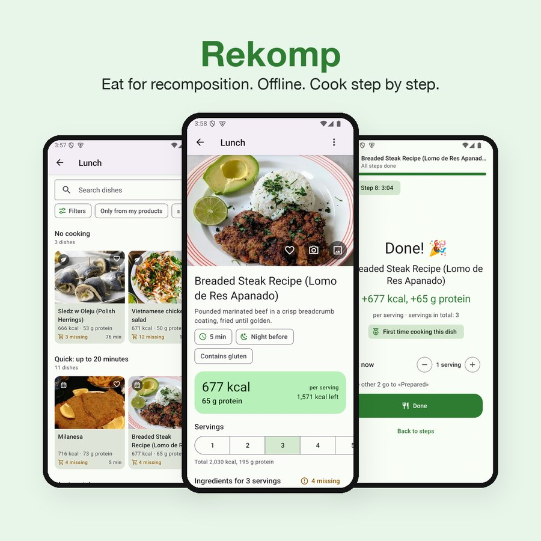
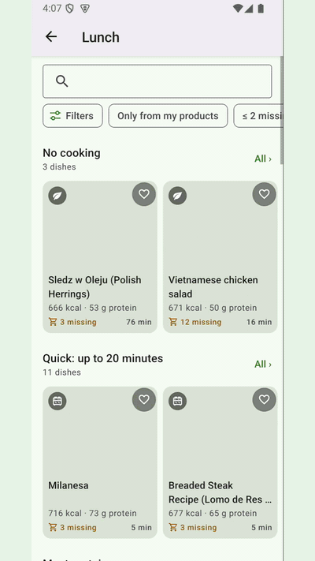
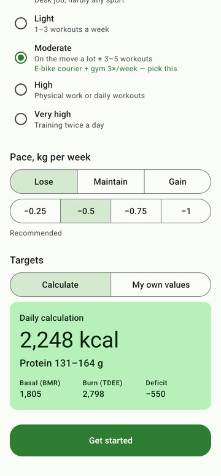
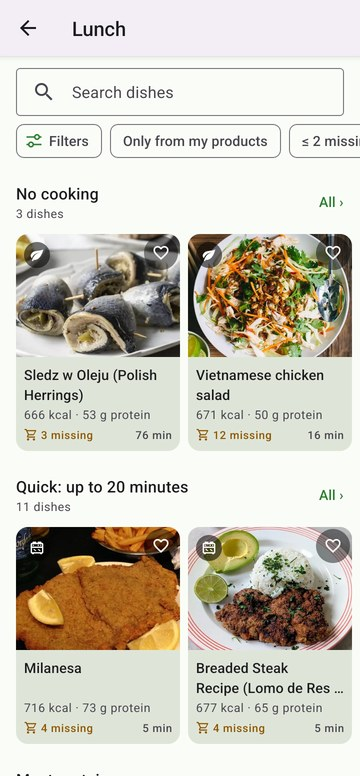
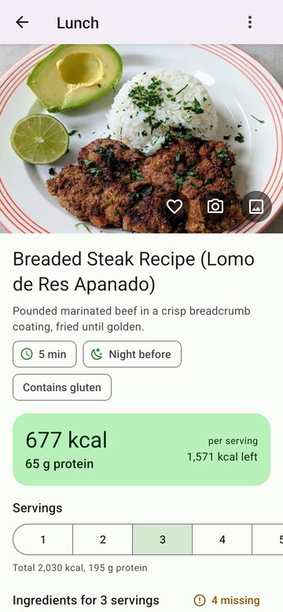
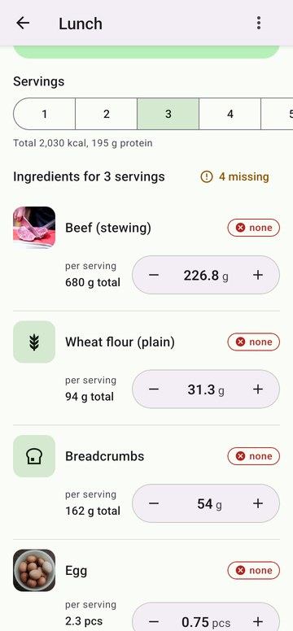
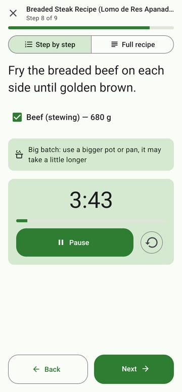
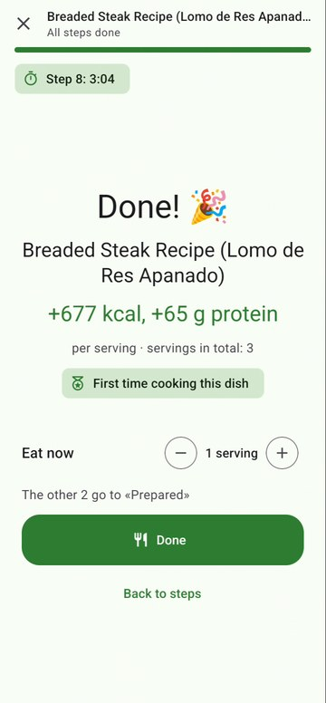
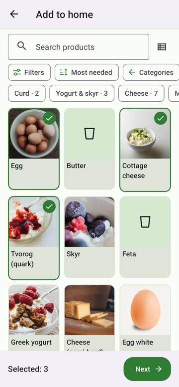
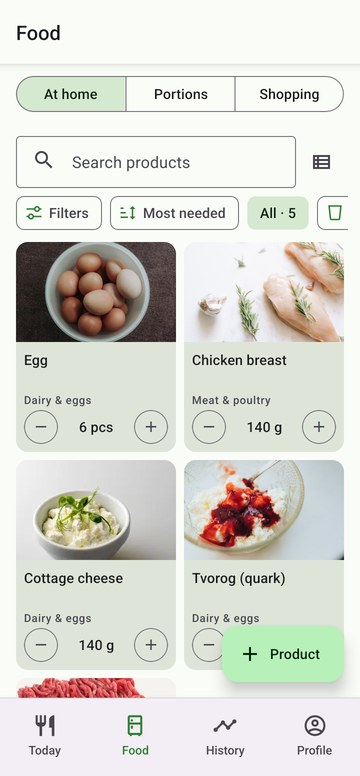

<div align="center">


# Rekomp

**Know what you can cook, cook it step by step, and hit your calories and protein, all offline.**

[](https://github.com/werter08/rekomp/releases/latest/download/rekomp.apk)




</div>

## Why

As a student I kept running the same loop with an AI chat: list everything in my fridge, ask what I could cook, ask for the steps, then after eating ask how many calories that was, because I was trying to stay in a calorie deficit. Every day.

Rekomp does both jobs. It knows what's at home, suggests dishes you can actually make, walks you through cooking them, and logs the calories and protein when you're done. No ads, no subscription, no account and no features you never use.

## Features

| | |
|---|---|
| 🎯 **Daily targets** | Calories (Mifflin–St Jeor, activity, weekly pace) and a protein range, or your own numbers |
| 🏠 **Product list** | Add what you have at home; dishes show what you can cook right now and what's missing |
| 🛒 **Shopping list** | One tap adds a dish's missing ingredients to the list |
| 🍽️ **75 dishes with photos** | Breakfast, lunch, snack and dinner, on shelves like *No cooking*, *Quick* and *Most protein*, with filters, sorting and search by ingredient |
| ⚖️ **Scale any recipe** | Pick servings, adjust grams; nutrition is calculated from the ingredients |
| 👨‍🍳 **Cooking mode** | Big text, per-step timers that keep running between steps, screen stays on, a notification when a timer ends |
| 🧊 **Cook once, eat for days** | Eat one serving now; the rest goes to *Ready in the fridge* |
| 📊 **Today & History** | Calorie and protein rings, per-meal split, 7/30-day charts, undo for the last entry |
| 🌍 **English & Russian** | Full UI and recipe translations, light and dark theme |
| 💾 **Your data stays yours** | Everything is local SQLite; export/import a JSON backup |

## Demo

<div align="center">

</div>

## Screenshots

<div align="center">




<br/>




</div>

## Install

1. Download **[rekomp.apk](https://github.com/werter08/rekomp/releases/latest/download/rekomp.apk)** from [Releases](https://github.com/werter08/rekomp/releases) on your Android phone (64-bit ARM, which covers almost all phones from the last several years).
2. Open it and allow installing from this source when Android asks.
3. Fill in your details on the first screen.

There's no iOS build yet. The code is cross-platform but has only been tested on Android.

## Tech stack

| Area | Choice |
|---|---|
| App | Expo SDK 57, React Native 0.86 (New Architecture, Hermes), React Compiler, TypeScript `strict` |
| Navigation | Expo Router (tabs + stacks) |
| UI | React Native Paper (Material 3), Reanimated, Gesture Handler, Gorhom Bottom Sheet, FlashList, expo-image |
| Data | expo-sqlite + Drizzle ORM with migrations and live queries; zustand only for UI and cooking-session state |
| Forms | react-hook-form + zod |
| Cooking | expo-keep-awake, expo-haptics, expo-notifications |
| i18n | i18next, expo-localization |
| Tests | Jest (jest-expo) + Testing Library; `src/domain` has a 100% coverage gate |

### Project layout

```
src/
  app/        Expo Router screens only (thin)
  domain/     pure logic: calculator, nutrition, pantry, servings, search (100% tested)
  db/         schema, migrations, repositories (the only place with SQL), catalog loader, backup
  features/   UI grouped by feature: today, recipes, cooking, pantry, history, profile
  ui/ theme/  shared components and design tokens
  i18n/       ru / en
tools/data-pipeline/   builds the bundled catalog (products, recipes, nutrition, translations)
```

Design rules: no nutrition maths in components. Pantry write-offs happen in one transaction with the log entry. "Done" is idempotent per cook session, and the last cook or log can be undone with the products returned.

## Development

```bash
npm install
npm run android        # dev build (expo run:android), needs JDK 17 + Android SDK
npm start              # Metro for an installed dev build
npm run typecheck && npm run lint && npm test
npm run test:coverage  # enforces 100% coverage of src/domain
npm run db:generate    # drizzle-kit migration after a schema change
```

Standalone APK:

```bash
cd android && ./gradlew assembleRelease -PreactNativeArchitectures=arm64-v8a
```

Photos are bundled. Re-fetching them needs a Pexels key in `.env.local` (see `.env.example`; never commit real keys):

```bash
npm run images:fetch
```

## Data & credits

- Nutrition: [USDA FoodData Central](https://fdc.nal.usda.gov/) (public domain) plus hand-checked values. All numbers are approximate.
- Some recipes are adapted from [TheMealDB](https://www.themealdb.com/); the rest are my own.
- Photos: [Pexels](https://www.pexels.com) contributors under the Pexels License. See [ATTRIBUTION.md](ATTRIBUTION.md).

Rekomp is not medical advice. Check with a professional before big diet changes.

## License

Code: [MIT](LICENSE). Photos keep their original Pexels license.
